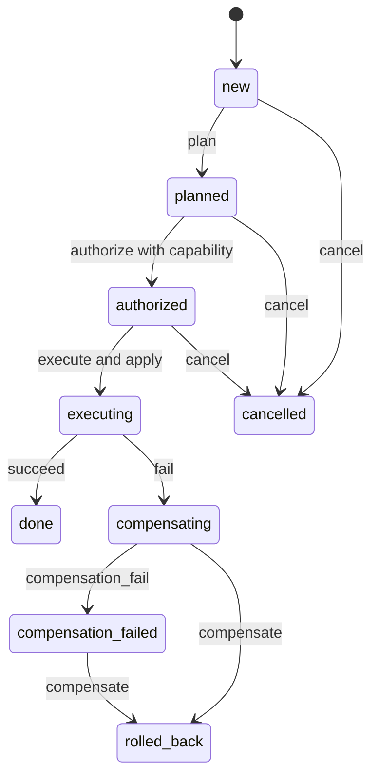

# Agent Policy State Machine

An executable policy boundary for one synthetic operation, with a finite TLA+
model and replayable evidence from the actual TLC model checker.

## Problem

An agent's intention to act is not authorization. Retried commands, late results,
and compensation failures also need explicit behavior. This project blocks
invalid synthetic effects inside the runtime, before they can occur.

## Scope

One in-memory operation, one immutable unit effect, an opaque approval capability,
accepted-event deduplication, and serialized dispatch. Tools and fixtures are
owned synthetic examples with no private data or external side effects.

The finite model covers nine event symbols and nine phases. It checks bounded
safety, not unbounded proof, liveness, or production security.

## Quick start

Python 3.11 or newer is required; runtime dependencies are standard-library only.

```sh
python3 -m venv .venv
.venv/bin/pip install .
.venv/bin/agent-policy plan forge execute authorize execute fail compensation_fail compensate
```

The first `execute` is rejected. After valid approval, execution applies one unit;
failure and eventual compensation return the balance to zero. Each line is JSON.
The CLI supplies its own approval capability for demonstration purposes.

## Usage

```python
from agent_policy import Event, Policy

approval = object()  # Retain in trusted application code.
policy = Policy(approval)
assert policy.dispatch(Event("p1", "plan")) == "accepted"
assert policy.dispatch(Event("e1", "execute")) == "rejected"
assert policy.dispatch(Event("a1", "authorize"), approval=approval) == "accepted"
assert policy.dispatch(Event("e1", "execute")) == "accepted"
assert policy.dispatch(Event("e1", "execute")) == "duplicate"
assert policy.snapshot().balance == 1
```

Accepted IDs are scoped to a Policy instance. Reusing one for another event kind
returns `conflict`. Rejected events do not reserve an ID. Invalid approval is
rejected even for a duplicate authorization. Snapshots are immutable copies.

## Architecture



[Runtime](src/agent_policy/runtime.py) uses imperative branches and a lock.
[Model](formal/Policy.tla) uses a separate transition relation.
[Conformance checker](scripts/replay.py) parses TLC's graph and drives the runtime
through a shortest path to every node and then every outgoing edge. It does not
reimplement the policy rules. See [design and trust boundaries](docs/design.md).

## Reproduction

The development lock pins dependency versions and hashes. Recorded local runs
used CPython 3.14.7, uv 0.8.23, Java 17.0.17 and TLC 2.19 from the upstream
[v1.7.4 release](https://github.com/tlaplus/tlaplus/releases/tag/v1.7.4).

```sh
UV_CACHE_DIR="$PWD/.tools/uv-cache" uv sync --frozen --python 3.14
.venv/bin/python scripts/replay.py
```

The lightweight replay requires no Java, downloads or third-party dependencies:

```sh
PYTHONPATH=src python3 scripts/replay.py
```

It verifies the checked-in hash manifest, checks graph completeness against TLC's
reported counts, replays 981 edges and blocks the faulty-model counterexample.
Hash verification establishes consistency, not measurement authenticity.

For a fresh TLC run, download the versioned JAR and verify it:

```sh
mkdir -p .tools
curl -fL https://github.com/tlaplus/tlaplus/releases/download/v1.7.4/tla2tools.jar -o .tools/tla2tools.jar
printf '%s  %s\n' 936a262061c914694dfd669a543be24573c45d5aa0ff20a8b96b23d01e050e88 .tools/tla2tools.jar | shasum -a 256 -c -
```

On the original measurement host, use its mandatory shared lock:

```sh
OMP_NUM_THREADS=1 OPENBLAS_NUM_THREADS=1 python3 /Users/luchoduran/Sites/open-source-projects/.coordination/benchmark_lock.py .venv/bin/python scripts/measure.py work/fresh
```

Elsewhere, serialize equivalent local workloads and run
`python3 scripts/measure.py work/fresh`. The recorder currently queries macOS
`sysctl` hardware metadata. The TLC commands in [measurement.json](evidence/measurement.json)
can be run directly on other platforms with adjusted paths; Java is limited to
one active processor, one worker and a 512 MiB heap. Use the host's required
benchmark wrapper when applicable. The intentionally faulty check must exit 12.
The recorder preserves both subprocess outputs before checking return codes.

## Results

| Actual local execution | Result |
| --- | --- |
| Correct TLC model | 982 states generated, 109 distinct, queue empty |
| Graph search depth | 8, with no depth cutoff |
| Checked safety | Types, authorization, accounting, rollback, terminal stability |
| Faulty model | Authorization violation after `plan`, `execute`; exit 12 |
| Faulty exploration | 14 generated and distinct states; stopped on violation |
| Runtime conformance | All 981 graph edges match; counterexample blocked |
| TLC wall time | Correct 1.085 s; faulty 1.085 s, including JVM startup |
| Runtime replay wall time | 0.138 s, including Python startup |

Measurements were taken on 2026-11-09 UTC using an Intel Xeon W-3223 at 3.50 GHz,
48 GiB system memory and macOS 26.7.1. These are single-run observations, not
throughput benchmarks. No energy, peak RSS, billing, or performance variance was
measured. No paid compute or inference service was used.

Raw evidence: [correct log](evidence/correct.log), [faulty counterexample](evidence/faulty.log),
[TLC graph](evidence/states.dot), [runtime observations](evidence/runtime-edges.jsonl),
[model metadata](evidence/measurement.json), [runtime metadata](evidence/runtime-measurement.json),
and [hash manifest](evidence/manifest.json). The metadata records exact measured
source commits and hashes. Later release commits add tests and documentation;
the manifest binds the measured runtime and model files to the release.

The first model attempt had a parser error, preserved in
[evidence/attempt-01](evidence/attempt-01). A strict DOT parser initially rejected
TLC rank metadata; its observed error is transcribed in [attempt-02](evidence/attempt-02.txt).
Neither failed attempt is counted as a successful verification.

## Testing

```sh
.venv/bin/pytest -q
.venv/bin/ruff check src scripts tests
.venv/bin/ruff format --check src scripts tests
.venv/bin/mypy src
.venv/bin/python scripts/replay.py
UV_CACHE_DIR="$PWD/.tools/uv-cache" uv build
python3 -m venv work/smoke
work/smoke/bin/pip install --no-deps dist/agent_policy_state_machine-0.1.0-py3-none-any.whl
work/smoke/bin/python -I -c 'from agent_policy import Policy; assert Policy(object()).snapshot().balance == 0'
work/smoke/bin/agent-policy plan authorize execute succeed
```

CI runs lint, formatting, strict runtime type checks, regression tests, offline
replay and an installed-wheel smoke check. It replays saved TLC evidence; it does
not claim a fresh hosted TLC measurement. Ordinary tests include real concurrent
dispatch, conflicts, invalid capabilities, cancellation, compensation recovery,
and mutations that must fail conformance. They are not formal verification.

## Limitations

The model fixes one ID per event kind and one operation. Fresh-ID conflicts and
threading are covered by ordinary tests, outside the model. Infinite traces are
not individually replayed. Representative histories per model state do not prove
refinement of arbitrary runtime histories. TLC reports an optimistic fingerprint
collision estimate of 5.2e-15 for the correct run.

There is no durable storage, crash recovery, revocation, user authentication,
external tool adapter, arbitrary plan payload, multi-operation transaction, or
remote exactly-once guarantee. Capability confidentiality and trusted Python
application code are assumptions. Compensation failure can remain unresolved;
no liveness or fairness property is claimed. Do not use the CLI as an authority.

## Contributing

Keep repository content in English, add regression tests for policy changes,
and document the corresponding formal-model change. Regenerate evidence under
an exclusive benchmark lock when changing measured behavior. Preserve negative
results and update source hashes. See [CONTRIBUTING.md](CONTRIBUTING.md).

## License

[MIT](LICENSE) applies to code, documentation, synthetic fixtures and locally
generated evidence. The TLC JAR is downloaded separately and is not redistributed;
its license and notices are provided by the upstream TLA+ project.
